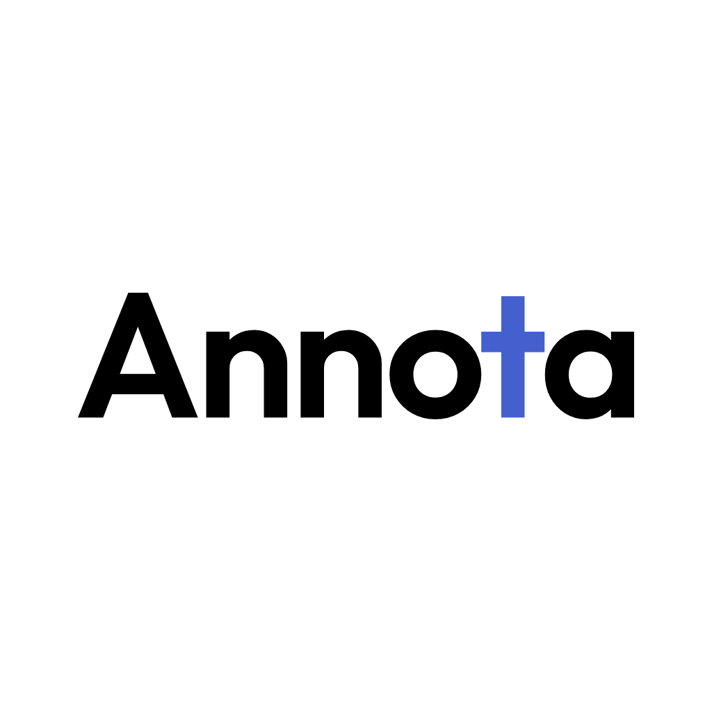

# Annota

Annota is a note app specifically designed for the Xiaomi Pad 9 Pro Max.

**纯本地，极简阅读，顺手记。**

Annota 围绕 PDF 阅读和手写笔记设计。没有账号、云空间或跨端同步；文件、笔迹、阅读进度和设置留在设备上。日常阅读、书写与查词不联网，只有用户主动获取更新或提交反馈时使用应用网络功能。

> 当前阶段是设计与交互原型，Android 原生实现正在推进。仓库尚无正式 APK，也没有已经接通的反馈服务。原型测试不能代替 Xiaomi 真机测试。

## 设计

- 单行紧凑顶栏，左侧页面导航、中间批注工具、右侧阅读选项分区。
- 单页或相邻两页并排阅读；缩略图侧栏按需打开。
- 笔、铅笔、钢笔、荧光笔、橡皮、直尺、图片、图形和手形工具。
- 离线英汉、汉英查词，支持选字后复制与查词，不承诺整句翻译。
- 快速笔记提供空白、点阵、格子、横线，以及白、灰、黑三种底色。
- 文件长按后收藏、重命名、复制、移动、导出 PDF 或移到废纸篓。
- 松间、晴昼、蓝调、原野四套外观，以及手写笔、手势和关于设置。
- 横版五页使用指南。首次初始化目标为指南和示例论文两份文件；示例论文的随包分发授权仍是发布前待办。

已选定唯一初始标识 **3B**：Outfit 600，钴蓝 t，圆角白底，字标在正方形内居中。



矢量母版、尺寸与字体出处见 [品牌资源](branding/README.md)。未采用的候选已从当前项目移出。

## 目前完成到哪里

| 部分 | 当前状态 |
| --- | --- |
| 主页、设置、反馈弹窗、阅读器、指南 | 已有交互原型和横竖屏验证 |
| 笔迹、页面操作、文字选择、复制、查词 | 已在示例原型验证，尚非通用原生实现 |
| 离线词典 | 已有数据构建与查询参考实现，原生宿主接入中 |
| 通用 PDF、本地持久化、真机笔事件 | Android 任务实现与验收范围 |
| 匿名反馈接口 | 协议已定义，服务尚未部署 |
| 签名 APK、覆盖升级、GitHub 更新 | 分发方案已确定，发布闭环尚未完成 |

具体缺口和验收条件见 [流程审计](docs/FLOW-AUDIT.md)，技术分工见 [原生实现方案](docs/ARCHITECTURE.md)。

## 下载与更新

首个可用版本完成后，签名 APK 会发布在 [GitHub Releases](https://github.com/dpan538/Annota/releases)。请下载 Release 附件中的 APK；GitHub 自动生成的 Source code ZIP 不是安装包。

首次从 GitHub 下载并安装，后续在「设置 → 关于 → 检查更新」查看版本说明，确认后下载 APK，由 Android 系统安装器完成更新。应用不会静默安装。更新使用固定包名与签名，并验证下载文件；覆盖升级需要保留原有本地笔记。

更新分发不需要另建业务后端。匿名反馈需要独立的小型服务，不能把 GitHub Token 放入 APK，也不会把联系方式直接公开到 Issue。详见 [APK 与更新分发](docs/DISTRIBUTION.md)。

## 本地查看设计原型

需要 Node.js 22+、Python 3.11+ 和 Chromium。安装开发依赖属于开发环境准备，不属于应用运行时联网。

```sh
npm ci
npx playwright install chromium
python3 -m pip install -r requirements-dev.txt
```

公开仓库保留可编辑源码，但不附带用户提供的论文全文、页图、文字坐标或个人文件。开发者需自行准备有权使用的 11 页示例 PDF，然后运行：

```sh
python3 design/render-reader-pdf.py /absolute/path/to/example.pdf
python3 design/extract-reader-text.py
python3 design/embed-fonts.py
python3 design/build-reader.py
npm run preview:build
```

打开生成的 `preview/index.html`。当前文字选取测试以原设计使用的 Attention Is All You Need 示例为基准；导入解析的通用实现属于 Android 任务，不把这个测试夹具当作正式 PDF 引擎。示例来源与分发边界见 [第三方说明](THIRD_PARTY_NOTICES.md)。

本地字体资源为官方原始 MiSans 切片，构建时直接嵌入，不修改字形或重新子集化；软件使用声明与原许可随项目保留。指南手写字体使用 OFL 授权的小赖字体子集。

```sh
npm run test:static
python3 design/dictionary/build.py
python3 design/dictionary/test_lookup.py
# 准备本地示例并构建后：
npm run test:reader
npm run test:guide
npm run test:library
```

原型状态容量受限，图片仅保留当前会话，请勿拿它存储重要笔记。

自动检查的配置模板见 [CI 配置](docs/ci/)。当前上传凭据没有工作流写入权限，模板尚未启用；上述检查均可在本地运行。

## 目录

```text
design/          界面源码、指南、原生事件协议与词典工具
branding/        已选定的唯一标识、字体出处与导出
docs/            流程审计、原生分工、隐私边界和分发方案
scripts/         开发环境检查、预览构建与视觉导出工具
android/         独立任务推进的原生工程，未完成代码不混入本次初始上传
feedback-service/ 匿名反馈服务的预留实现区域
```

## 反馈

功能建议和公开问题可在 [GitHub Issues](https://github.com/dpan538/Annota/issues) 提出。不要把私人文件、联系方式或敏感日志发到公开 Issue。未来应用内反馈是独立匿名通道；未接通时只保留草稿，不显示虚假的提交成功。

## 许可

- 原创源代码与工程文档：[MIT](LICENSE)。
- 原创 Logo、插图、指南正文及其图文版式：[CC BY-NC 4.0](LICENSE-VISUALS.md)，署名后仅限非商业使用。
- MiSans、小赖字体、Lucide、ECDICT、CC-CEDICT 及第三方论文：各自许可独立适用，详见 [第三方说明](THIRD_PARTY_NOTICES.md)。

本项目独立开发，与 Xiaomi 没有隶属或官方合作关系。设备名用于说明设计目标。
