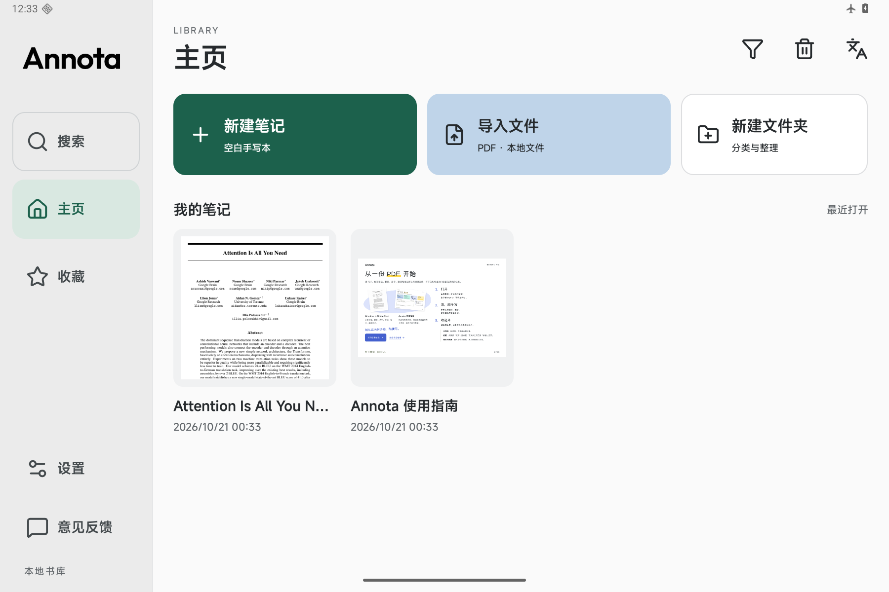
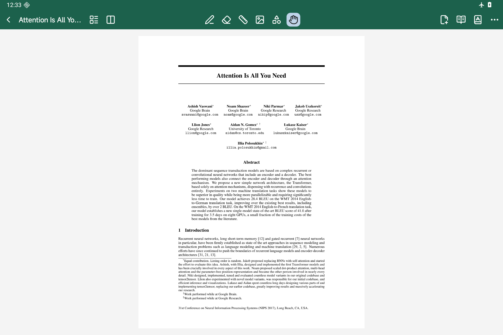

# Annota

**纯本地，极简阅读，顺手记。**

面向小米平板 9 Pro Max 的 PDF 阅读器与手写批注本。没有账号、云空间和跨端同步，文件、笔迹、阅读进度和设置都在本机；断网也能读、能写、能查词。

[](https://github.com/dpan538/Annota/blob/main/DOWNLOAD.md)


<table width="100%">
  <tr>
    <td width="50%"></td>
    <td width="50%"></td>
  </tr>
</table>

当前为开发测试版，尚无正式签名 Release。仅主动获取更新、提交反馈时使用应用网络功能。

## 目录

[下载](#下载) · [界面](#界面) · [顶栏](#顶栏) · [实现](#实现) · [数字](#数字) · [不做](#不做) · [构建](#构建) · [测试](#测试) · [反馈](#反馈) · [许可](#许可) · [English](#english)

## 下载

[下载安装包 ↗](https://github.com/dpan538/Annota/releases/download/v0.1.8-dev/Annota-0.1.8-dev.apk) · [固定下载页](DOWNLOAD.md)

直接点击，或复制下载页中的链接到平板浏览器。下载完成后按系统提示安装。当前为开发测试包，尚非正式版。

## 界面

| 位置 | 内容 |
| --- | --- |
| 主页左侧 | 搜索、主页、收藏、设置、意见反馈 |
| 主页上方 | 新建笔记、导入文件、新建文件夹；右上角筛选、废纸篓、中英文切换 |
| 阅读器顶部 | 页面导航、批注工具、阅读选项 |

默认适宽，单页或相邻双页连续上下滚动；支持惯性滑动、双指缩放与阅读位置恢复，缩略图列表按需打开。四套外观：松间、晴昼、蓝调、原野。圆角新建面板直接预览空白、点阵、格子、横线四种纸，选择白、灰、黑底色并命名。文件长按可收藏、重命名、复制、移动、导出 PDF、移进废纸篓。

首次启动只有横版五页指南和 11 页 *Attention Is All You Need* 示例论文；封面读取真实首页。删除后重启或升级都不补回。

## 顶栏

横屏设计坐标 1024 × 682⅔，参考画幅 3408 × 2272。阅读器保持一行三组，底部不放页码和操作条：

| 区 | 入口 |
| --- | --- |
| 左 | 返回书库、缩略图、单/双页 |
| 中 | 笔、橡皮、直尺、图片、图形、手形 |
| 右 | 新增页、阅读模式、词典、更多 |

纯阅读使用独立入口：收起批注工具，单击正文隐藏/显示顶栏，长按查词；「批注」一键返回原工具。阅读显示只提供原始、柔和、清晰三个预设，按文档记住选择，切换保留位置。手形仍是批注界面的浏览工具。

四种笔、粗细与颜色收在笔菜单。书库、设置、阅读器及小菜单的控件支持 60 / 68 / 76 三档，点击即时生效。

## 实现

| 环节 | 做法 |
| --- | --- |
| 墨迹 | 标准 MotionEvent 压感与历史采样；抬笔提交矢量笔迹；最近 50 步撤销状态可跨进程恢复 |
| 词典 | 随包英汉、汉英 SQLite 索引词库；安装校验后本地只读查询，支持词形、拼写候选与局部语境简释，其他义项折叠 |
| 更新 | GitHub 测试更新已走通模拟器下载、校验和系统覆盖安装；生产签名与真机安装仍待验收 |
| 存储 | 私有本地文件与原子状态快照；同签名覆盖升级保留数据，支持导出备份与合并恢复 |
| 内存 | 首页只读封面元数据；位图与文字缓存按堆预算限额，后台回收、前台重建 |

标准笔输入与手势已做模拟器回归；小米真机、系统手写输入法待验收，专有双击、轻捏与笔震动尚未启用。

## 数字

以下是目标预算，尚非目标小米平板实测成绩：

| 指标 | 目标 |
| --- | --- |
| 冷启动到书库可点 | ≤ 800 ms |
| 落笔到出墨 | ≤ 1 帧 |
| 翻页（相邻页已解码） | ≤ 100 ms |
| 词典查询 | ≤ 20 ms |
| 空载常驻内存 | ≤ 120 MB |
| APK | 单包，不分 ABI |

实测随 Release 记录设备与条件。

## 不做

- 云同步、账号、协作。笔记留在本机，不设上传通道。
- 整句翻译。保留离线查词，不加联网翻译或大模型包。
- OCR。扫描件不假装能选字。
- 手机版和 iPad 版。首期围绕目标平板验收。
- 接管系统文件关联。PDF 从应用内导入。

## 构建

需要完整 JDK 17/21、Android SDK platform 36 与 build-tools 35.0.0。

```sh
git clone https://github.com/dpan538/Annota.git
cd Annota/android
./gradlew :app:assembleDebug
adb install -r app/build/outputs/apk/debug/app-debug.apk
```

开发包用本机 debug 签名；发布签名经 `ANNOTA_KEYSTORE` 等环境变量配置，密钥不入库。见 [Android 构建](android/README.md)。`design/` 是可运行的 HTML 原型，依赖与预览步骤见 [设计说明](design/README.md)。仓库包含随包原始示例论文，生成页图与预览不另行入库。

## 测试

```sh
cd android
./gradlew :app:assembleDebug :app:assembleDebugAndroidTest :app:lintDebug
./gradlew :app:connectedDebugAndroidTest
cd ..
npm run test:static
npm run test:reader && npm run test:guide && npm run test:library
python3 design/dictionary/test_lookup.py
```

仪器测试会重置书库，仅在专用模拟器运行；更新校验需先放入同签名夹具。浏览器测试需先构建原型，自动断言与截图复核共同验收。实际结果、性能边界与剩余工作见 [验收记录](docs/READING-MODE-ACCEPTANCE.md)、[测试 log](log/README.md) 和 [流程审计](docs/FLOW-AUDIT.md)。

## 反馈

公开问题走 [GitHub Issues](https://github.com/dpan538/Annota/issues)，别贴私人文件、联系方式和完整日志。应用内「意见反馈」是匿名通道，不自动附带设备标识或文档；公网接口尚未配置，未收到真实回执就保留本地草稿。见 [隐私说明](docs/PRIVACY.md)。

## 许可

- 原创代码与工程文档：[MIT](LICENSE)
- 原创标识、插图、指南正文及版式：[CC BY-NC 4.0](LICENSE-VISUALS.md)，署名、仅限非商业
- Outfit、MiSans、小赖字体、Lucide、ECDICT、CC-CEDICT、示例论文：各自许可，见 [第三方说明](THIRD_PARTY_NOTICES.md)；论文分发边界见 [随包说明](android/app/src/main/assets/SAMPLE-PAPER-NOTICE.md)

独立开发，与 Xiaomi 没有隶属或官方合作关系，设备名只说明设计目标。

## English

A local-first PDF reader and handwriting notebook for the Xiaomi Pad 9 Pro Max. Files, strokes, reading position and settings stay on the device. No account, cloud or sync. Offline ECDICT/CC-CEDICT lookup; networking only for requested updates and feedback.

Read mode has a slim toolbar and only Original / Soft / Clear display presets. Tap the document to toggle chrome, long press for offline lookup, and tap Annotate to restore the previous tool.

Development APK available through [GitHub Releases](https://github.com/dpan538/Annota/releases/tag/v0.1.8-dev); Xiaomi hardware, production signing and the stable-update flow remain pending. MIT for code; CC BY-NC 4.0 for original artwork and the guide.
