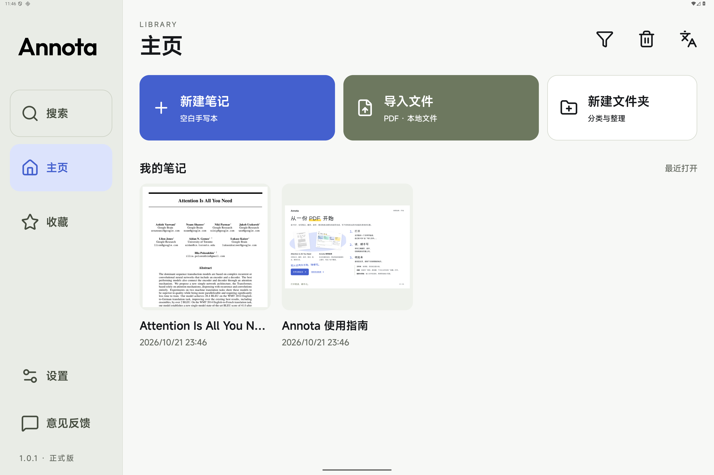
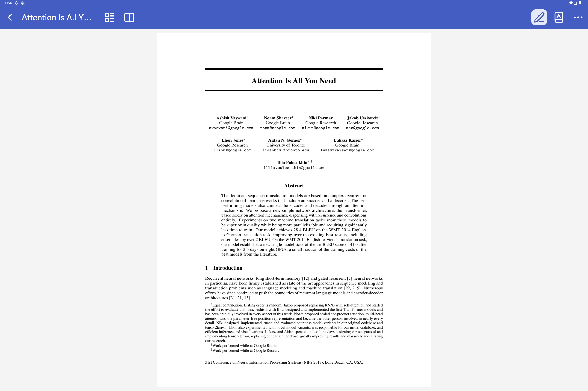
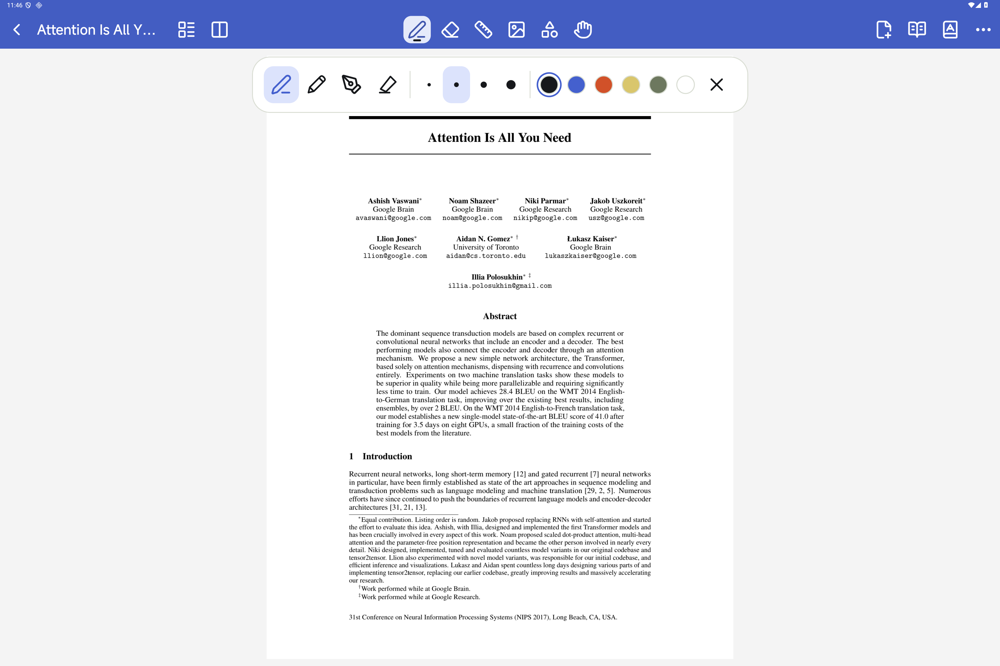
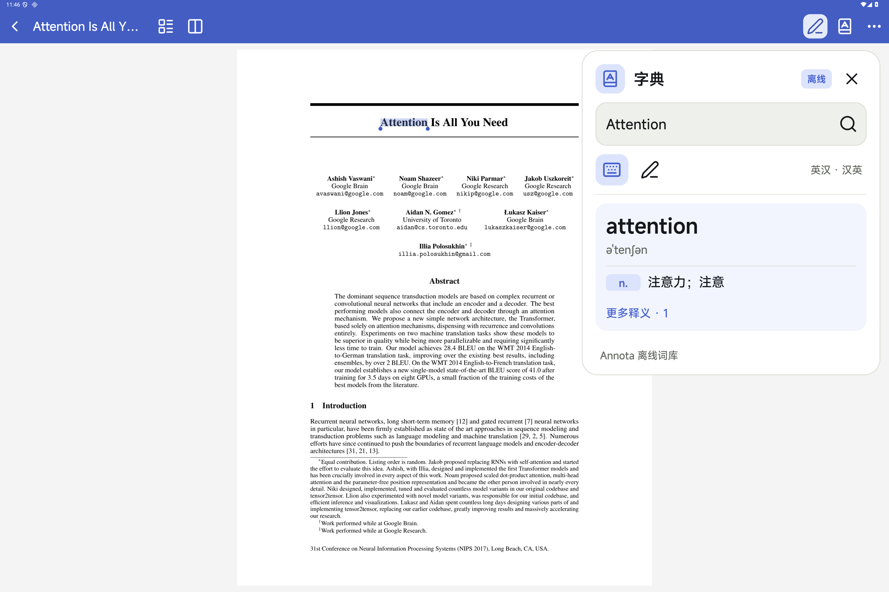
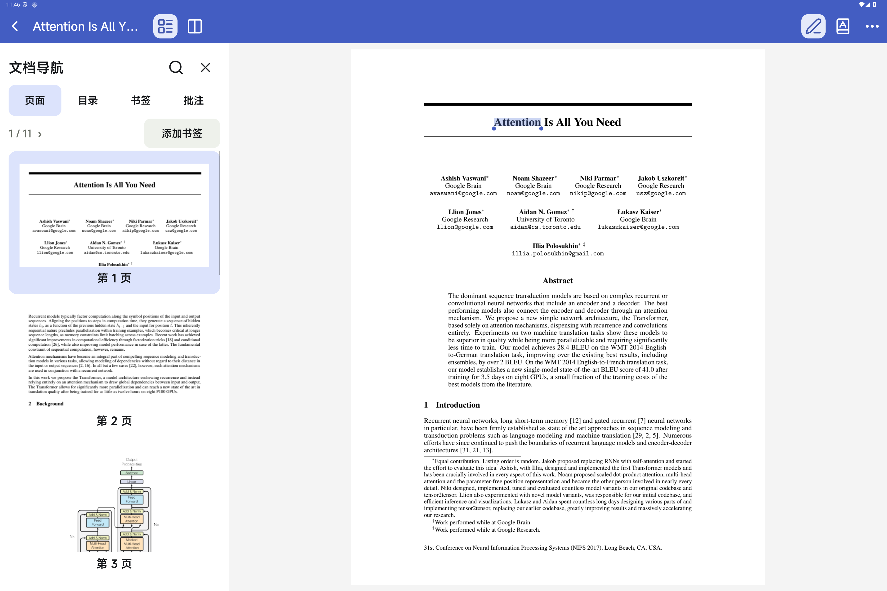
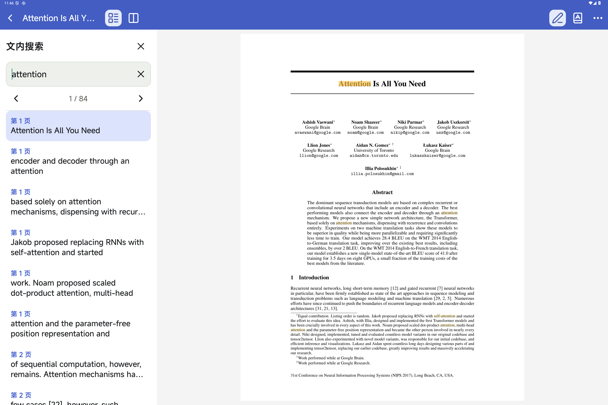

# Annota

**本地 PDF 阅读与手写批注。打开文档，专注阅读，随手记录。**

为 Android 平板设计，围绕小米平板 9 Pro Max 优化。PDF、笔迹、阅读位置和设置保存在设备上；阅读、书写和英汉 / 汉英查词均可离线使用，无需账号。

[](https://github.com/dpan538/Annota/releases/tag/v1.0.2)

[](LICENSE)

[**下载 Android APK**](https://github.com/dpan538/Annota/releases/download/v1.0.2/Annota-1.0.2.apk) · [版本说明](https://github.com/dpan538/Annota/releases/tag/v1.0.2) · [下载与安装](DOWNLOAD.md) · [English](#english)

当前 **1.0.2 正式版** 增加「更多 → 手写签名」，支持移动、等比缩放、撤销与 PDF 导出；修复权限检查导致的部分已签名及受限 PDF 导入失败。正式包沿用已有证书，可覆盖升级并保留文档与批注。1.0.0 是首个正式版，1.0.1 修正阅读偏黄。详见 [签名验收说明](docs/PDF-SIGNATURE-ACCEPTANCE.md)。

## 从书库到阅读

以下为原生 Android 应用的实际截图，统一使用**蓝调**外观。阅读场景均使用随包的 *Attention Is All You Need* 原始 PDF，点击图片可查看大图。

<table>
  <tr>
    <td width="50%" valign="top">
      <a href="docs/images/readme-library-blue.png"></a>
      <b>01 · 管理本地文档</b><br>
      新建笔记、导入 PDF、整理文件夹；搜索、收藏与文件类型筛选就在书库中。
    </td>
    <td width="50%" valign="top">
      <a href="docs/images/readme-reading-blue.png"></a>
      <b>02 · 专注阅读原文</b><br>
      阅读模式收起批注工具，顶栏中央留空；单击正文显隐顶栏，缩放后继续阅读。
    </td>
  </tr>
  <tr>
    <td width="50%" valign="top">
      <a href="docs/images/readme-pen-blue.png"></a>
      <b>03 · 切换工具，随手批注</b><br>
      单击切换笔或橡皮，再次点击展开参数；笔型、粗细与颜色集中在居中小菜单。
    </td>
    <td width="50%" valign="top">
      <a href="docs/images/readme-dictionary-blue.png"></a>
      <b>04 · 就地离线查词</b><br>
      长按选词后复制或查词；结合局部语境显示简释，其他义项按需展开。
    </td>
  </tr>
  <tr>
    <td width="50%" valign="top">
      <a href="docs/images/readme-pages-blue.png"></a>
      <b>05 · 快速定位页面</b><br>
      在同一侧栏切换页面、PDF 目录、书签和批注预览；点击页码直接跳页。
    </td>
    <td width="50%" valign="top">
      <a href="docs/images/readme-search-blue.png"></a>
      <b>06 · 搜索后回到原处</b><br>
      原页高亮匹配内容，切换前后结果；关闭搜索时可回到开始搜索的位置。
    </td>
  </tr>
</table>

## 可以做什么

| 场景 | 功能 |
| --- | --- |
| PDF 阅读 | 原始 PDF 高清分块渲染、连续滚动、惯性滑动、双指缩放、单页 / 相邻双页、阅读位置恢复 |
| 手写批注 | 笔、铅笔、钢笔、荧光笔；压感与历史采样、整笔 / 局部橡皮、直尺辅助、图形与图片、撤销 / 重做 |
| 手写签名 | 独立签名画布、移动与等比缩放、单步撤销；签名随 PDF 导出，受限文件只读打开 |
| 离线查词 | 随包英汉 / 汉英 SQLite 词库，支持词形、拼写候选、局部语境简释；选区手柄可扩展同页跨行文字 |
| 文档整理 | 文件夹、搜索、收藏、重命名、复制、移动与废纸篓；真实首页封面、PDF 目录、页书签、批注预览 |
| 新建与导出 | 空白、点阵、格子、横线纸；白 / 灰 / 黑底色；导出 PDF、本地 `.annota.zip` 备份与合并恢复 |
| 外部打开 | 接收其他应用的 PDF“打开 / 分享”，复制到私有书库；重复分享复用已有文档，支持导入进度、取消和失败重试 |
| 日常使用 | 可调整大小的“继续阅读”安卓桌面小组件；松间 / 晴昼 / 蓝调 / 原野四套外观、中英文界面、60 / 68 / 76 三档按键尺寸 |

首次打开包含五页使用指南和 11 页示例论文。删除后，重启或升级不会重新补回示例文档。

## 第一次使用

1. **打开文档**：在书库导入 PDF，或先打开示例论文。其他应用提供“用其他应用打开 / 分享”时，也可选择 Annota；实际入口取决于发送方提供的文件权限。
2. **阅读与记录**：阅读模式专注浏览；点击笔图标进入批注，手形工具用于批注时拖动页面。工具切换后保留原有阅读位置。
3. **查找与保存**：长按选词查词；通过侧栏或“更多”搜索、跳页和添加书签。本地内容自动保存，需要带走文档时导出 PDF 或备份。

需要签字时，在「更多 → 手写签名」录入，放到页面上调整位置与大小后确认。已带数字签名的文件若另存批注副本，应用会提示原数字签名的验证效力不随副本保留；原件不改写。

阅读显示只保留“原始 / 柔和 / 清晰”三个预设，位于“更多 → 阅读显示”，按文档记住选择。新文档默认原始白底；柔和只做中性的明暗调整，清晰略微增强对比。显示预设不修改源 PDF、笔迹或导出颜色。

## 数据、更新与反馈

- **本地优先**：没有账号、云同步或协作服务，文档与手写内容不上传。卸载或清除数据前，请先导出或制作本地备份；恢复时校验内容并合并导入。
- **GitHub 更新**：在“设置 → 关于”检查版本。下载后校验包名、版本、SHA-256 与签名，再交给 Android 系统覆盖安装。正式包为非调试 Release 构建，应用和仓库均标明“正式版”。
- **自动反馈**：在应用内填写并点击提交，由 Vercel 接收服务创建公开 GitHub Issue。真实收到后自动提示“已收到反馈”；网络或服务失败会提示并保留草稿，无需手动检查结果。请勿填写私人文档或联系方式。

应用网络仅用于用户主动触发的更新与反馈。详见 [隐私说明](docs/PRIVACY.md)、[分发与签名](docs/DISTRIBUTION.md) 和 [首版验收](docs/INTEGRATION-ACCEPTANCE.md)。

## 平台与范围

Android 10 及以上，首期面向大屏平板；设计与交互围绕小米平板 9 Pro Max。标准触控笔压感、历史采样、笔尾 / 侧键与触摸手势已接入，厂商专有双击、轻捏和笔震动尚未启用。

保留原始 PDF 版式，不提供 OCR、整句翻译或在线大模型。扫描件可以阅读和批注，可选文字取决于 PDF 是否有文本层。当前不提供 iPad 版、手机版专门适配或跨端同步。

用户已完成此前功能的真机测试；新增集成和自动化证据来自 Android 16 / API 36 ARM64 专用模拟器，不代表覆盖所有厂商桌面、输入法与分享客户端。公开 APK 下载、真实系统覆盖升级、自动 GitHub 反馈及数据保留记录可在 [验收记录](docs/INTEGRATION-ACCEPTANCE.md) 查看。

## 开发与验证

原生 Kotlin / Android Views；系统 `PdfRenderer` 按可见区域渲染原始 PDF，PDFBox 负责页面与导出处理；笔迹保存为矢量状态，最近 50 步撤销状态可跨进程恢复；词库使用本地 SQLite 索引，首页按需读取封面，渲染缓存随堆预算回收。`design/` 保留可运行的 HTML 设计原型，发布应用以原生工程为准。

需要 JDK 17 / 21、Android SDK Platform 36 和 Build Tools 36.0.0。

```sh
git clone https://github.com/dpan538/Annota.git
cd Annota/android
./gradlew :app:assembleDebug
adb install -r app/build/outputs/apk/debug/app-debug.apk
```

开发包使用本机 debug 签名。正式签名通过 `ANNOTA_KEYSTORE` 等构建环境变量配置，密钥不入库。构建与测试夹具说明见 [Android 工程](android/README.md)，原型预览见 [设计说明](design/README.md)。

<details>
<summary>测试命令与性能目标</summary>

```sh
cd android
./gradlew :app:assembleDebug :app:assembleDebugAndroidTest :app:lintDebug
./gradlew :app:connectedDebugAndroidTest
cd ..
npm run test:static
npm run test:reader && npm run test:guide && npm run test:library
python3 design/dictionary/test_lookup.py
python3 -m unittest discover -s feedback-service -p test_github_relay.py -v
```

仪器测试会重置本地书库，仅在专用模拟器执行；更新测试需先准备更高版本的同签名夹具。自动断言和截图复核共同验收，设备与条件随版本记录。

以下为性能目标，不能当作目标小米平板的实测成绩：冷启动至书库可用 ≤ 800 ms，出墨 ≤ 1 帧，相邻已解码页切换 ≤ 100 ms，词典查询 ≤ 20 ms，空载常驻内存 ≤ 120 MB。APK 使用单包分发，不按 ABI 拆分。实际记录见 [实现状态](docs/IMPLEMENTATION-STATUS.md)、[测试记录](log/README.md) 与 [流程审计](docs/FLOW-AUDIT.md)。

</details>

## 许可与致谢

- 原创代码与工程文档：[MIT](LICENSE)。
- 原创标识、插图、指南正文及版式：[CC BY-NC 4.0](LICENSE-VISUALS.md)，署名、仅限非商业使用。
- Outfit、MiSans、小赖字体、Lucide、ECDICT、CC-CEDICT 与示例论文遵循各自许可，见 [第三方说明](THIRD_PARTY_NOTICES.md) 及 [示例论文说明](android/app/src/main/assets/SAMPLE-PAPER-NOTICE.md)。

独立开发，与 Xiaomi 没有隶属或官方合作关系；设备名称仅说明设计目标。

## English

**Local PDF reading and handwriting for Android tablets.** Built around the Xiaomi Pad 9 Pro Max, with files, ink and reading positions kept on the device. Reading, annotation and English–Chinese / Chinese–English lookup work offline without an account.

- High-resolution original PDF rendering, continuous scrolling, zoom and single / adjacent-page layouts.
- Pen tools, pressure input, erasing, ruler, shapes, images and undo / redo.
- Handwritten signatures with positioning, proportional resizing and PDF export; signed/restricted PDF compatibility with original-file preservation.
- Context-aware offline lookup, document search, PDF outline, bookmarks and annotation previews.
- PDF open / share intents, local backup / restore and a resizable continue-reading home widget.
- GitHub updates with verified in-place installation; automatic feedback acknowledgement after a real GitHub Issue is created.

[Download the stable APK](https://github.com/dpan538/Annota/releases/download/v1.0.2/Annota-1.0.2.apk). Version 1.0.2 adds handwritten signatures and fixes permission-based PDF import failures. Version 1.0.0 was the first stable release; 1.0.1 removed the warm color cast. All screenshots above use the same blue theme and the bundled original *Attention Is All You Need* PDF. Code is MIT; original artwork and guide are CC BY-NC 4.0.
