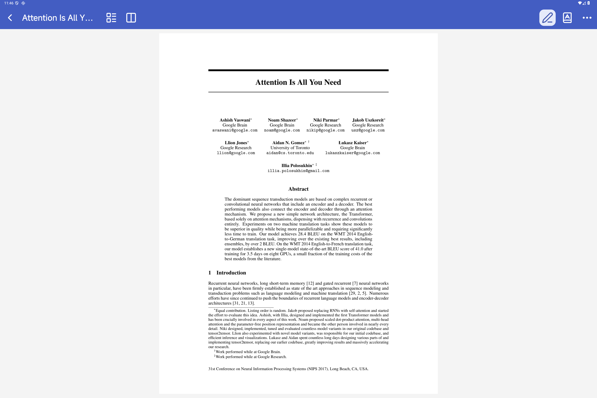
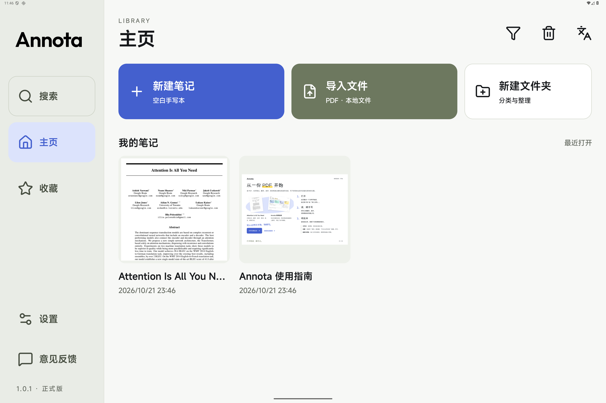
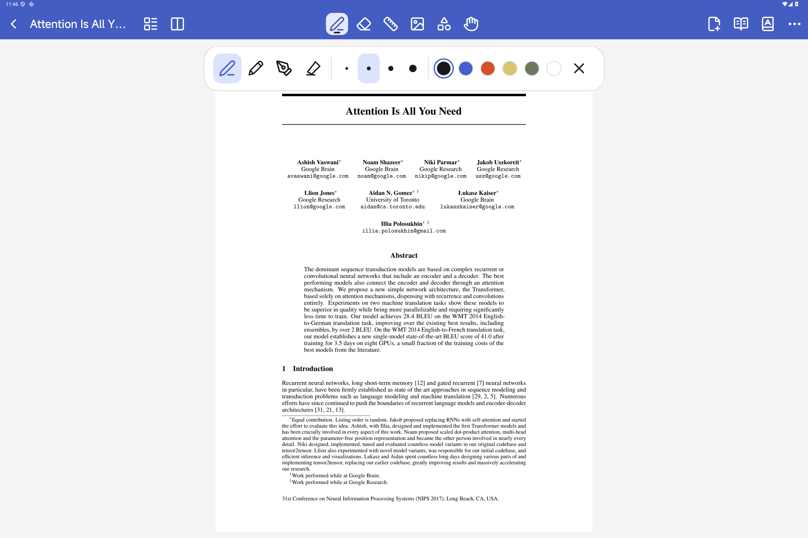
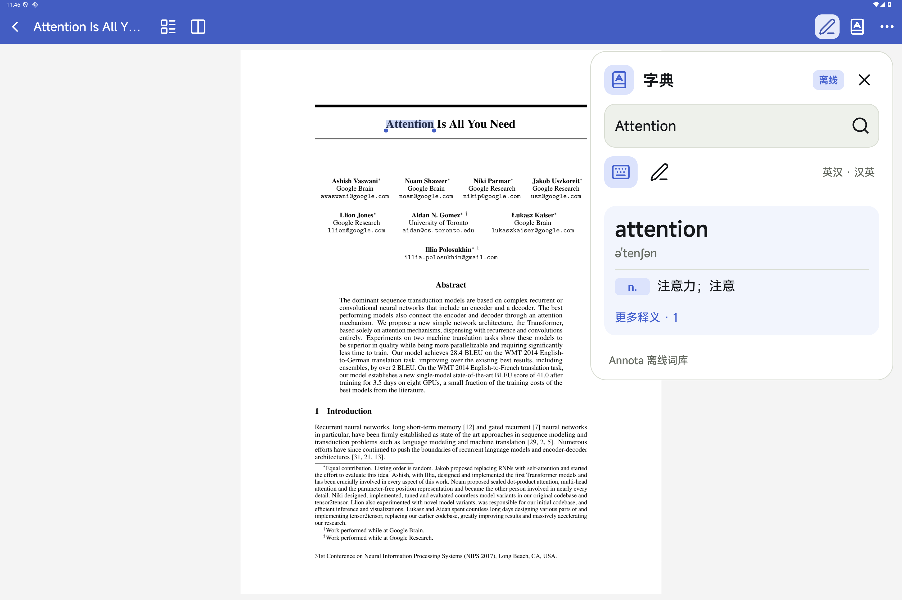
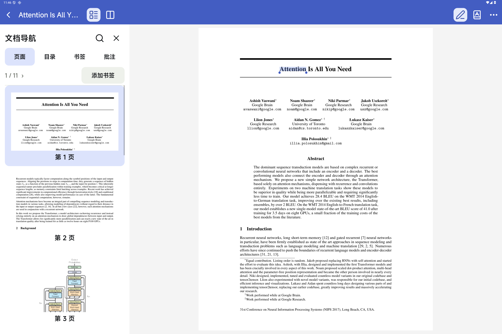

# Annota

[中文](README.md) · [English](README_EN.md)

**打开文档，专注阅读，随手记录。**

本地 PDF 阅读与手写批注应用，围绕 **Xiaomi Pad 9 Pro Max** 优化。无需账号，文档、笔迹、阅读进度和查词都留在设备上。

[](DOWNLOAD.md)
[](https://github.com/dpan538/Annota/releases/tag/v1.0.6-preview)
[](https://github.com/dpan538/Annota/releases/tag/v1.0.2)
[](LICENSE)

[**下载 Beta APK**](https://github.com/dpan538/Annota/releases/download/v1.0.6-preview/Annota-1.0.6-preview.apk) · [下载正式版](https://github.com/dpan538/Annota/releases/download/v1.0.2/Annota-1.0.2.apk) · [安装说明](DOWNLOAD.md) · [更新日志](CHANGELOG.md)



[特色](#特色) · [快速开始](#快速开始) · [功能预览](#功能预览) · [开发](#开发) · [许可](#许可)

## 特色

- **专注阅读** — 原始 PDF 分块渲染、连续滚动、双指缩放与相邻双页；文内搜索、目录、书签和阅读位置恢复。
- **自然批注** — 笔、铅笔、钢笔与荧光笔；压感、停笔拉直、水平吸附直尺，框选移动 / 缩放 / 旋转，撤销与重做。支持手写签名及 PDF 导出。
- **离线查词** — 内置约 **77 万条英汉、12.6 万条汉英记录**，支持词形、词组和局部语境简释。未整体收录的词组可分段查看；词库随 APK 更新，无需下载语言包。暂不提供整句翻译。
- **本地书库** — 文件夹、收藏、搜索与废纸篓；接收其他应用分享的 PDF，本地 `.annota.zip` 备份与恢复，桌面小组件继续阅读。

以上描述以当前 Beta 为准。[版本差异与已知范围](CHANGELOG.md)。

## 快速开始

1. 安装 APK，打开随包的 *Attention Is All You Need* 或导入自己的 PDF；首次使用可查看内置指南。
2. 点击笔图标开始批注，阅读模式收起批注工具；长按文字可复制或离线查词。
3. 内容自动保存在本机。需要带走或备份时，导出 PDF 或完整备份包。

**适配目标：Xiaomi Pad 9 Pro Max。** Android 10+ 是安装要求，不代表其他设备已完成适配。扫描件可以阅读和批注；选词与搜索需要 PDF 文本层。暂不提供 OCR、iPad 版、云同步或证书数字签名。

## 功能预览

实际应用截图，统一使用蓝调外观；点击图片可看大图。

| 本地书库 | 画笔与批注 |
| --- | --- |
| [](docs/images/readme-library-blue.png) | [](docs/images/readme-pen-blue.png) |
| 导入文件，按文件夹与收藏整理。 | 在原文上记录，切换工具保留阅读位置。 |

| 离线查词 | 页面导航 |
| --- | --- |
| [](docs/images/readme-dictionary-blue.png) | [](docs/images/readme-pages-blue.png) |
| 就地查看简释，更多义项按需展开。 | 缩略图、目录、书签与批注集中在侧栏。 |

## 数据与更新

阅读、书写及查词完全离线；仅主动检查应用更新、下载 APK 或提交反馈使用网络。反馈会提交为公开 GitHub Issue，请勿附上私人内容。卸载或清除应用数据前，请先备份。

当前 **1.0.6-preview 为 Beta 测试版**，默认更新检查会提供此版本；下载和安装均需用户确认。沿用已有安装证书，支持覆盖升级。最近正式版为 **1.0.2**。

## 开发

原生 Kotlin / Android Views，系统 PdfRenderer、PDFBox 与本地 SQLite。需要 JDK 17 / 21、Android SDK 36、Build Tools 36.0.0。

```sh
git clone https://github.com/dpan538/Annota.git
cd Annota/android
./gradlew :app:assembleDebug
```

[Android 工程与签名](android/README.md) · [测试与验收](docs/testing.md) · [离线词库构建](design/dictionary/README.md) · [设计原型](design/README.md) · [反馈问题](https://github.com/dpan538/Annota/issues)

## 许可

代码：[MIT](LICENSE)。原创视觉与指南：[CC BY-NC 4.0](LICENSE-VISUALS.md)。字体、图标、词库及示例论文遵循各自许可，见[第三方说明](THIRD_PARTY_NOTICES.md)。

独立开发，与 Xiaomi 没有隶属或官方合作关系。
