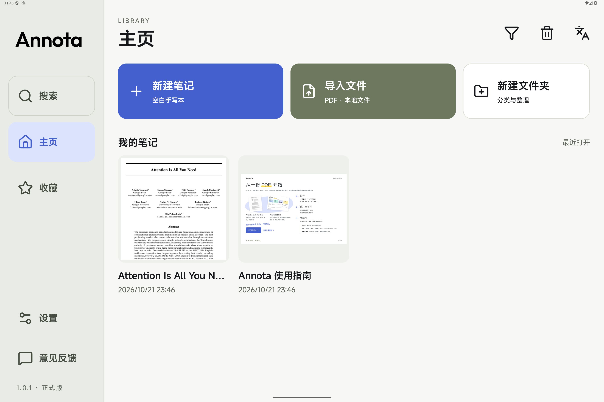
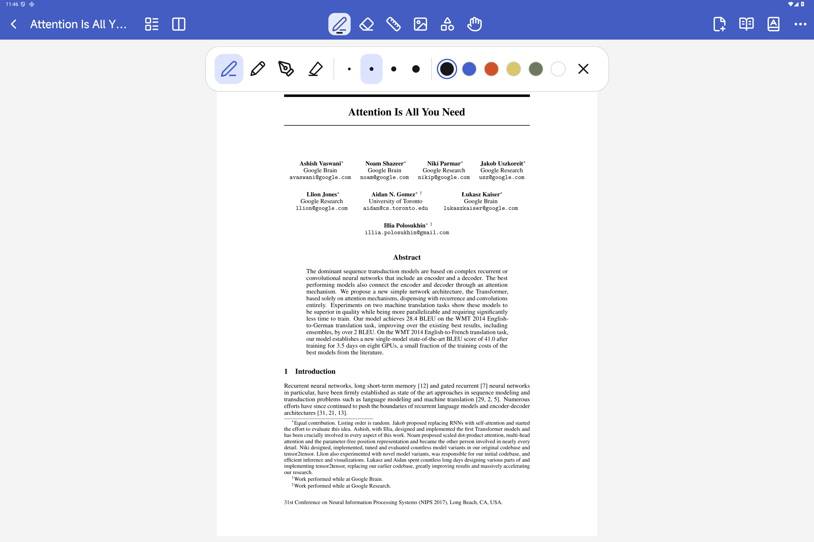
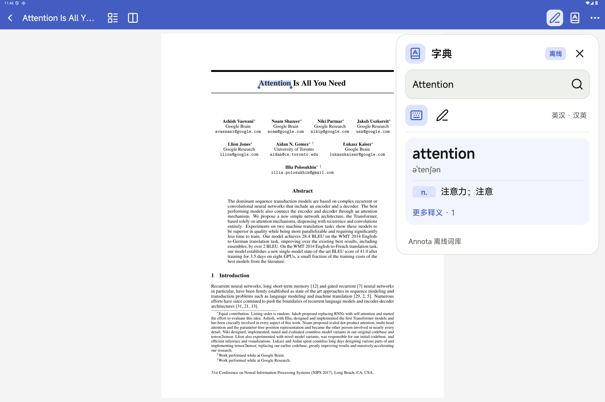
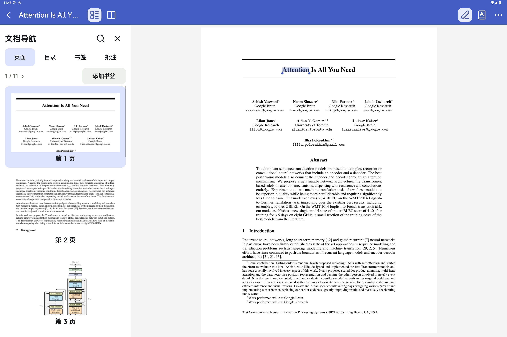

# Annota

[中文](README.md) · [English](README_EN.md)

A local PDF reader and handwriting annotation app optimized for the **Xiaomi Pad 9 Pro Max**. No account: documents, ink, reading position and lookups stay on the device.

[](DOWNLOAD.md)
[](https://github.com/dpan538/Annota/releases/tag/v1.2.0)
[](https://github.com/dpan538/Annota/releases/tag/v1.2.1.4)
[](LICENSE)


[**Download 1.2.1.4 preview APK**](https://github.com/dpan538/Annota/releases/download/v1.2.1.4/Annota-1.2.1.4.apk) · [Download 1.2.0 stable APK](https://github.com/dpan538/Annota/releases/download/v1.2.0/Annota-1.2.0.apk) · [Installation](DOWNLOAD.md) · [Changelog](CHANGELOG.md)

> 1.2.1.4 is a preview; real-device acceptance is still in progress. Install 1.2.0 if you need the most stable build. Both use the same certificate and upgrade in place.

## Features

- **Reading**: continuous scroll, pinch zoom, adjacent spread, in-document search, outline, bookmarks and position restore.
- **Handwriting**: pen, pencil, fountain pen and highlighter; pressure, ruler, move/scale/rotate selection, undo/redo, signature and PDF export.
- **Annotations**: draggable/resizable text boxes with keyboard input; sized partial/whole eraser; shapes and images.
- **Offline dictionary**: English–Chinese and Chinese–English lookup, professional terms, context-aware senses, fallback English definitions and short English sentence translation, all bundled in the APK.
- **Local library**: folders, favorites, search, trash, PDF sharing import, full backup and restore.

**Target device: Xiaomi Pad 9 Pro Max.** Android 10+ is an installation requirement, not a claim that other devices are supported. Scanned PDFs can be read and annotated; selection/search need a text layer. OCR, an iPad version, cloud sync and certificate signing are not provided.

## Quick start

1. Install the APK, open the bundled *Attention Is All You Need*, or import a PDF.
2. Annotate from the toolbar; reading mode hides the tools. Long-press text to copy or look it up offline.
3. Content is saved on device automatically. Export a PDF or full backup to take it elsewhere.

## Screenshots

| Library | Handwriting |
| --- | --- |
| [](docs/images/readme-library-blue.png) | [](docs/images/readme-pen-blue.png) |

| Offline dictionary | Page navigation |
| --- | --- |
| [](docs/images/readme-dictionary-blue.png) | [](docs/images/readme-pages-blue.png) |

## Offline dictionary

Lookups run entirely on device. Dictionaries cover English–Chinese, Chinese–English, professional terminology and several sense sources; ambiguous words are ranked with the current context, and other senses remain available when evidence is weak. When no Chinese definition exists, a clearly labelled English definition is shown; traditional-Chinese queries expand to simplified automatically. Short English passages can show a reference translation (English → Simplified Chinese); verify professional content.

Dictionaries, models and sense vectors ship with the APK and are not downloaded on first use. Semantic reranking can be disabled under Settings → About; ordinary offline lookup keeps working. See [local data](docs/PRIVACY.md).

## Data and updates

Reading, handwriting, lookup and reference translation work offline. Network is used only when you check for updates, download an APK or submit feedback. Back up before uninstalling or clearing app data.

In-app updates see the latest preview (versionCode 28). To stay on the stable release, install or keep 1.2.0 manually.

## Build

Native Kotlin / Android Views, system PdfRenderer, PDFBox and local SQLite. Requires JDK 17 / 21, Android SDK 36 and Build Tools 36.0.0.

```sh
git clone https://github.com/dpan538/Annota.git
cd Annota/android
./gradlew :app:assembleDebug
```

[Android project and signing](android/README.md) · [Testing](docs/testing.md) · [Dictionary build](design/dictionary/README.md) · [Issues](https://github.com/dpan538/Annota/issues)

## License

Code: [MIT](LICENSE). Original visuals and guides: [CC BY-NC 4.0](LICENSE-VISUALS.md). Fonts, icons, dictionaries and the sample paper follow their own licenses; see [third-party notices](THIRD_PARTY_NOTICES.md).

Independent project; not affiliated with or endorsed by Xiaomi.
