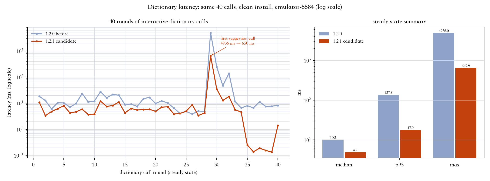
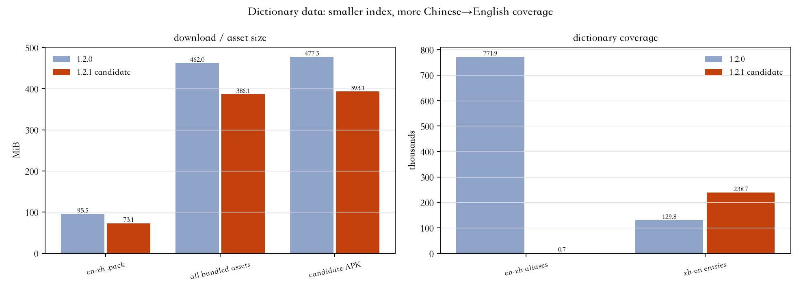
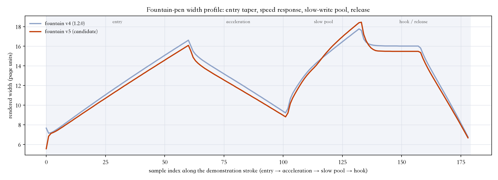
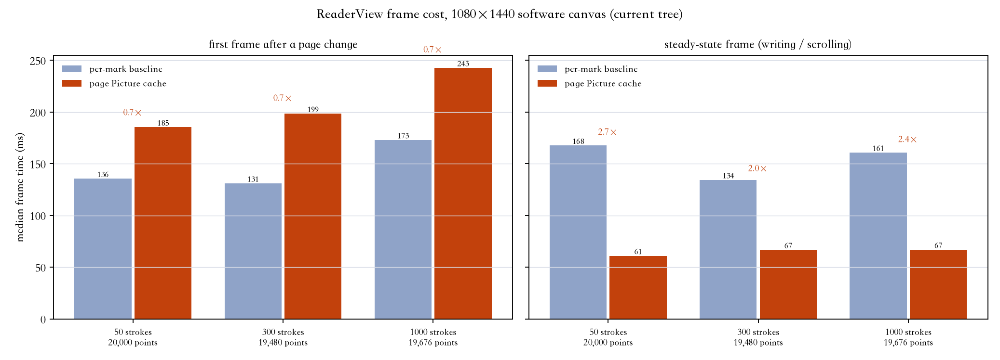
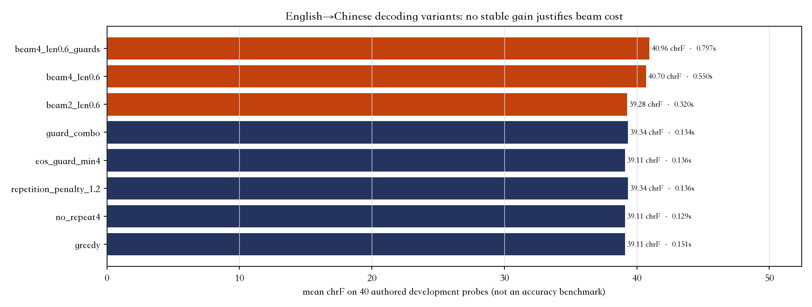

# 1.2.1 候选验收可视化（未发布）

本目录是 **1.2.1 / versionCode 23** 开发候选的验收材料：同一台模拟器（API 36 ARM64
`emulator-5584`，断网）、同一批查询与同一组笔迹，对比公开 **1.2.0** 与当前候选。
候选没有发布：默认更新通道仍是 1.2.0，仓库不创建 Release/tag。

## 1. 字典实时调用：40 轮前后对比

同一测试 `DictionaryLatencyAcceptanceTest` 在 1.2.0 与候选 APK 上各运行一次：清洁安装、同一
40 条查询（单词/词组/中文/拼写建议/未收录/缩写）。`first` 为每个词首次查询；`warm` 为重新打开
字典后的稳态（进程与磁盘页已热、结果缓存已清空）——这是“实时查词”最接近的指标；
`repeat` 为同一词的即时重查（内存缓存命中）。

| 指标（40 轮） | 1.2.0 | 候选 | 变化 |
| --- | ---: | ---: | ---: |
| warm 中位数 | 10.17 ms | **4.92 ms** | **2.07× 更快** |
| warm p95 | 137.79 ms | **17.90 ms** | **7.70× 更快** |
| warm 最大 | 4935.98 ms | **649.93 ms** | **7.59× 更快** |
| warm 总耗时 | 5756.72 ms | **897.66 ms** | **6.41× 更快** |
| repeat 中位数（缓存） | 0.00175 ms | 0.00158 ms | 同量级 |
| 首次安装解压/校验 | 3392 ms | 2034 ms | 1.67× 更快 |

> 最大项来自首个拼写建议查询（模拟器冷页 I/O 的一次性成本）；中位数与 p95 更能代表连续使用。
> 全部 40 轮原始数据：`before/dictionary-latency.json`、`after/dictionary-latency.json`。



## 2. 数据与安装包体积



- en-zh `aliases` 从 771,862 行降到 682 行（删除逐词复制的边界索引，新增 `entries.boundary_key`）。
- en-zh 数据库 240.9 → 194.4 MB；`.pack` 95.45 → 73.1 MiB。
- 汉英库 129,801 → 238,664 条（反向生成 108,863 条）。
- 四个数据库全部改为 `.pack`；词库资产 462 → 386 MiB；候选 APK **477.3 → 393.1 MiB（−84.2 MiB）**。
- 新增 128 条作者缩写与 401,909 条首字母索引；WordNet 86,060 条词义带领域标签。

## 3. 笔迹前后对比（钢笔 v5）

同一组作者笔迹（5 条 / 409 点）与同一条 179 点演示笔迹，分别用 **1.2.0 的 v4 钢笔几何**与
**候选的 v5 钢笔几何**离屏渲染。v4 渲染在两次构建中的 SHA-256 完全一致（像素级不变），
只有新笔迹使用 v5；屏幕与 PDF 共用同一几何。




- v5 的可见差异：起笔更细的 taper、随速度变化的粗细、慢写段轻微增宽（池墨）、收笔收细；
  尖角与钩保留，不磨圆；单点仍清晰。
- 宽度剖面来自实际 `InkGeometry.samples`（179 个采样），不是示意图。
- 旧笔迹、屏幕/PDF 对拍与 v4 golden 位级检查见 `after/ink-acceptance.json` 与
  `ink-performance/` 中的 P3 测试记录。


## 4. 手感/帧耗时（P1）

同一软件画布（1080×1440）下，已完成笔迹改为按页 `Picture` 缓存、活动笔迹实时叠加：



| 页面内容 | 首帧 旧 → 新 | 稳态帧 旧 → 新 | 稳态提升 |
| --- | ---: | ---: | ---: |
| 50 条 / 20,000 点 | 134.4 → 187.4 ms | 173.7 → **60.0 ms** | 2.89× |
| 300 条 / 19,480 点 | 133.8 → 203.6 ms | 135.2 → **67.4 ms** | 2.01× |
| 1000 条 / 19,676 点 | 174.4 → 247.4 ms | 173.7 → **67.9 ms** | 2.56× |

- 像素对拍：Picture 重放 vs 逐 mark 绘制，50/300/1000 条、约 2 万点，**changed=0、
  maxChannelDelta=0**；undo/redo 像素还原 0 差异。
- 首帧（页面首次出现/提交后一帧）多出 display-list 记录成本，是已知代价；硬件层下主线程
  稳态每帧只剩 1 个 `drawPicture` op，软件画布数值是保守下界。
- 真机笔尖-墨迹延迟仍需在 Xiaomi Pad 9 Pro Max 上验收。

## 5. 英→中整句翻译（辅助材料）

40 条自写开发集上比较解码变体；beam 的 chrF 增益区间含 0 且耗时 3.6×，因此未改默认贪心解码，
只增加零推理成本的中文标点/空格/句末后处理。详见 `design/translation/evaluation/variant-report.json`。



## 6. 缩写与上下文新能力（功能验证）

- 缩写/数字缩合：`AbbreviationLookupTest` 7/7 通过；`CAP` 在 theorem 语境给 CAP 定理、在
  farm/subsidy 语境给共同农业政策；`k8s`/`i18n`/`a11y`/`l10n` 可识别；`CAPs`、`CAP's` 支持；
  小写 `cap` 仍是普通单词。
- 领域上下文：`SenseDomainRankingTest` 7/7 通过；16 条开发探针 9 改善 / 0 回归 / 7 中性
  （作者探针，非准确率）；无上下文与弱证据顺序不变。

## 7. 构建与回归

- 候选 APK：`Annota-1.2.1-candidate.apk`，**412,171,912 B（约 393.1 MiB）**，SHA-256
  `a14c9874f6f03e6b8172c19fadd1cf926ed19c46aad56a5581037ac7e36421cb`，证书沿用
  `90e5c38e…be18`；资源/签名/安装/冷启动验证通过（`apk-candidate.json`，冷启动 1,208 ms）。
- 仪器化回归：**223 / 223 通过**（断网模拟器，覆盖词典、缩写、领域、笔迹 P1/P3、P2 存量回归）。
  `DocumentNavigationTest` 的 2 个长按选词 popup 用例未纳入 gate：它们在 **1.2.0 基线 APK 上
  同样失败**（同一设备/环境），与本轮改动无关，记录保留。
- Python：`test_lookup.py` 18 项、`test_lexicons.py` 20 项通过。`build.py` 两次运行 SQLite
  SHA-256 一致。
- **未发布**：没有创建 GitHub Release/tag，`annota-update.json` 未更新，默认更新通道仍是 1.2.0。
- 真机（Xiaomi Pad 9 Pro Max）的笔感、帧率、发热与内存仍需用户验收；模拟器数据不代表真机。

## 复现

```sh
# 1.2.0 基线（git worktree 或 release APK 对应的 debug 构建）
adb install -r -d /tmp/annota-before/android/app/build/outputs/apk/debug/app-debug.apk
adb install -r /tmp/annota-before/android/app/build/outputs/apk/androidTest/debug/app-debug-androidTest.apk
adb shell am instrument -w -e class \
  io.github.dpan538.annota.DictionaryLatencyAcceptanceTest#recordsFortyRoundLatency,\
io.github.dpan538.annota.InkAcceptanceComparisonTest#writesFountainPenComparisonImages \
  io.github.dpan538.annota.test/androidx.test.runner.AndroidJUnitRunner

# 候选
adb install -r android/app/build/outputs/apk/debug/app-debug.apk
adb install -r android/app/build/outputs/apk/androidTest/debug/app-debug-androidTest.apk
# 同上运行两条验收测试，然后拉取 files/dictionary-acceptance 与 files/ink-acceptance
MPLCONFIGDIR=/tmp/mpl-config python3 make_charts.py
```
