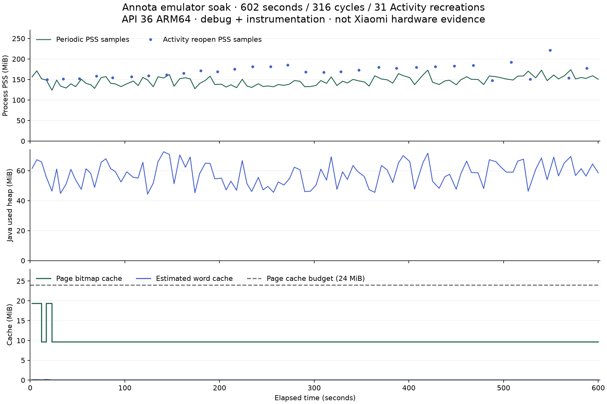

# 316 轮持续使用测试

2026-10-21，Australia/Brisbane。本记录针对 API 36 ARM64 专用平板模拟器上的 0.1.4-dev / versionCode 5 开发包，带 Android 仪器测试，不是 Xiaomi Pad 或真实手写笔测试。

## 做了什么

连续运行 602 秒，共 316 轮。每轮翻页、等待 PDF 与文字缓存就绪，新增一条含 40 个压感点的笔迹并持久化，查询离线词典、读取书库摘要并核对保存状态。每五轮触发缓存回收/重建，每十轮销毁并重新打开 Activity，共重开 31 次；最后重新读取书库验证新增 316 条笔迹都在。

测试没有重启整个 Android 进程。真正的进程重启、模拟器重启与同签名覆盖升级是[另一轮验收](../../docs/READER-ACCEPTANCE.md)，不能把两轮记录混写成同一实验。

## 结果与曲线



| 项目 | 实际观测 |
| --- | --- |
| 仪器测试 | 1 项通过，日志 `OK (1 test)` |
| 持续时间 / 轮次 / Activity 重开 | 602 秒 / 316 轮 / 31 次 |
| 新增笔迹 / 点 | 316 条 / 12,640 点 |
| 保存状态 | 轮次间及重开后核对一致，无断言失败或 OOM |
| 采样进程 PSS | 127,030–226,946 KiB，含重开时的采样 |
| 常规采样 Java 已用堆峰值 | 76,172,288 bytes |
| 常规采样页面位图缓存峰值 / 预算 | 20,283,200 / 25,165,824 bytes |

曲线中的蓝色点是 Activity 重开时另行记录的 PSS；常规采样与重开采样没有相互替代。重开附近出现短时峰值，例如第 290 轮 226,946 KiB、第 300 轮 157,546 KiB。这里持续增加文档笔迹，负载并非恒定；图表的时间采样也无法捕捉任意瞬间峰值。

这份记录支持“在给定模拟器和十分钟负载下，保存/恢复与缓存限额断言通过”。它不证明无内存泄漏、不代表空载内存 ≤120 MB，也不能替代小米真机数小时运行、发热、笔尖延迟、固件压感与掌触验收。

## 证据与版本

- [原始仪器输出](instrumentation.txt)，含每十轮的重开记录。
- [结构化采样](measurements.json)、[CSV](samples.csv)、[SVG 曲线](memory-curve.svg)。CSV 明确标出 periodic / activity-reopen 两类采样。
- [被测构建身份与源码哈希](tested-build.json)。被测 APK SHA-256：`68f6174498a5c2803b731343f54def7368b242d51f8b01a2c6eca225d6ff0bcf`。
- 之后只调整 `SettingsContent.kt` 的主题描边范围/圆角及关于页中文短句，最终 APK 哈希因此不同。此次持续测试没有重跑成另一个“316 轮”；读取器、存储、PDF、词典与缓存代码哈希保持相同。最终包另外运行完整回归和下载/启动检查，见[本轮验收](../../docs/ENGLISH-APK-ACCEPTANCE.md)。

## 复跑

仅在没有用户数据的专用模拟器执行；测试会重置测试书库。先按 [Android README](../../android/README.md) 构建、安装目标 APK 与测试 APK，再运行：

```sh
adb shell am instrument -w -e class io.github.dpan538.annota.SoakTest -e soakSeconds 600 \
  io.github.dpan538.annota.test/androidx.test.runner.AndroidJUnitRunner
adb exec-out run-as io.github.dpan538.annota cat cache/english-soak.json > measurements-new.json
```

生成已归档曲线需要 Python 与 Matplotlib，在仓库根目录运行 `python3 log/plot-soak.py`。生成脚本只读取本目录固定记录，输出 PNG、SVG、CSV；新实验应新建目录保留原始记录，不覆盖这次实验。

## 后续描述可引用

“为本地 PDF 笔记设计并执行 Android 模拟器持续使用测试：602 秒完成 316 轮渲染、增量笔迹保存、离线查词和缓存回收，31 次 Activity 重开后保存状态一致，页面缓存采样保持在 24 MiB 预算内。保留构建哈希、原始输出及内存曲线；小米真机手写与长时性能另行验收。”
